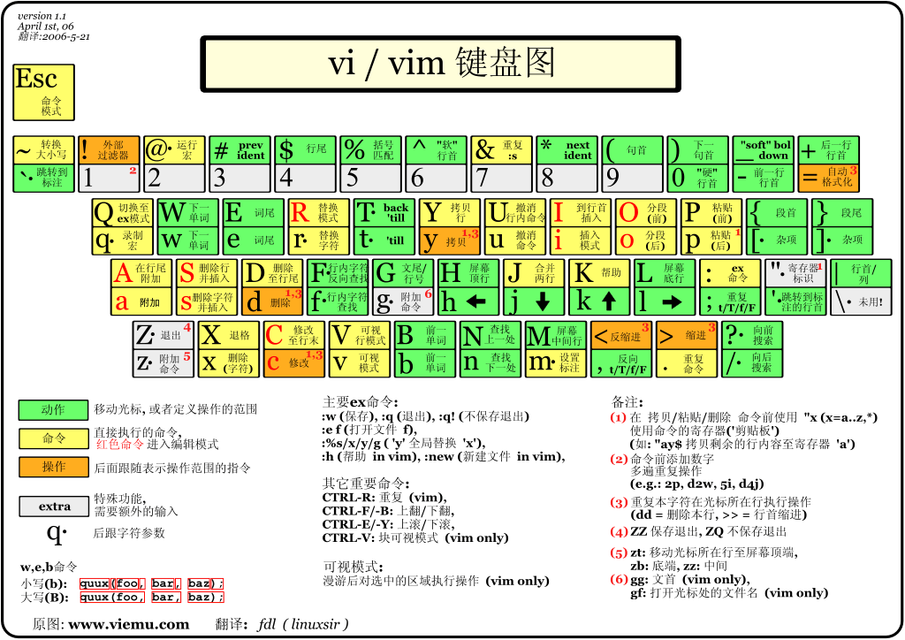

# 笔记

## 第一章 Markdown笔记

### 内容一 标题

标题使用`#␣ + 标题`来识别**标题**，上下都是换行，间隔出来
标题分为很多种，一级，二级，三级等等，在markdown中，区别不同级别的标题的方式就是`#`的个数，一级就是一个`#`，二级就是两个`##` ，这个完成后,我们会很自然想到，正文是什么，其实正文就是不带任何标识的文字

标题锚点，这是个特殊内容，其效果是**点击标题跳转到对应位置**，其使用方式是`[跳转到方法论部分](#方法论)`
举例是[笔记](#笔记),

### 内容二 文本格式

---

#### 强调

**加粗**，其用法是在内容的前后都**加上**`**`符号，就是加粗
*倾斜*，其用法比**加粗**容易，因为其是在内容前后都**加上一个**`*`符号
衍生用法是三个`***`符号，***加粗且倾斜***，
==高亮==，用法是在内容前后**加上**`==`符号，这就是==高亮==
~~删除~~，用法是在内容前后**加上**`~~`符号，这就是~~删除~~

---

#### 列表

markdown支持有序和无序列表
无序列表可以使用`*`,`-`,`+`作为无序的开始，然后补以空格来使用,一般推荐使用`-`号来作为无序的开头，比较清晰，其要求也是前面是==换行==或者==空格==例如：

- first
- second
- third
有序列表一般是数字+空格`N +.+ ␣`,数字可以不连续，但是显示的数字是连续的，另外，其可以通过设置二或四个空格来进行嵌套

1. first
2. second
3. third

需要注意的是，两个列表中间要有内容，

1. first
   1. second
2. third

---

---
换行，你想换行可以使用两个空格，或者两个`enter`键  我的显示

---
分割线是连续的`---`，此外其上方最好不要有内容，使用个换行换一下
比较特殊的是下划线，在markdown里没有明确的下划线，所以使用的是html里的标签形式`<u>文本</u>`

---
然后在任何文章的最后，还需要添加一个换行，这样才不会报错

### 内容四 特殊文本形式

脚注也是一个比较特殊的内容，因为其的特殊形式，很少有使用的吧
但是我需要特别给其提示出来

---

#### 表格

表格比较特殊,其使用的方式是`|`以及`---`的结合，比如，用`|`来区分不同单元格，用`|---|`来区分表头和其他，
其注意事项是，要有空格

| 表头 | 表头 | 表头 |
| ---- | ---- | --- |
| 数据 | 数据 | 数据3 |
| test | user | data |

---

#### 脚注

脚注是文本的补充，其格式也比较明显，要补充的文本需要给的格式是`[^要注明的文本]`，
而给出的脚注则是`[^要注明的文本]:注释`,
举例如同[^footnote]
[^footnote]:没错，这真的是一个脚注

很神奇，脚注会自动加一个分割线，并归类到最后一行，

---

#### 代码标注

代码标注分为两种类型，行内代码标注，区块代码标注
这两的区别不大，主要是一个小范围，只用一两个函数或者标注特殊形式而已，另一个则是适合很多地方，
比如，要写一整段代码，其使用方式也是一样的，唯一区别就是数量，行内代码标注是一个`` ` ``，区块是`` ``` ``，没错，就是三个一样的`反引号`，特别的，当你要标注的里面有反引号的时候，你可以用``` `` ```或者`` ``` ``区分来[^为什么会出现两个或者三个反引号呢]

[^为什么会出现两个或者三个反引号呢]:因为会出现两种情况，第一，就是标注一个或者三个反引号的时候，用``` `` ```很容易，但是如果要标注``` `` ```的时候，反而不好显示了，所以这时使用`` ``` ``就是最好的方式了，虽然一个`` ` ``也可以，但是容易提前闭合，所以最好使用三个。

而区块代码标注则如下，使用三个到四个反引号`` ` ``标注出来，同时，如果你要高亮代码的话，可以==标注==出其对应的计算机语言，但是如果你不在意标注的==高亮==，其实也可以使用`text`来作为标注，这代表是输入的是纯文本，如此就不会有任何标识

```` c
```c
#include <stdio.h>
    void main(void){

        return 0;
    }
```
````

不同语言显示效果也不一样

```python
def calculate_area(radius):
    """计算圆的面积"""
    import math
    return math.pi * radius ** 2

# 使用函数
area = calculate_area(5)
print(f"圆的面积是: {area:.2f}")
```

区块代码除了使用三到四个反引号`` ` ``，也可以使用四个空格`␣␣␣␣`或者制表符`tab`，

````text
    缩进来展示代码
    每行都需要缩进
    但是建议在一个文本中，只使用一种形式，围栏式```或者缩进式␣␣␣␣
````

---

#### 任务复选框

任务复选框的条条框框比较多，其格式为 `␣-␣[␣]␣`和`␣-␣[x]␣`，这两个分别代表==未选中==和==选中==，

比如，

- [x] 我的世界
- [ ] 迷你世界

---

#### 引用块

这方面的用法就更少了，但是其包容万象，其使用方式就是在内容前加`>`符号

> **用户反馈**：这个功能很有用！
> > **开发团队回复**：感谢您的反馈，我们会继续优化。
> > > **项目经理补充**：预计下个版本会有更多改进。

#### 链接

链接的使用方式一般是`[链接名称](链接地址)`，`[链接文字](链接地址 "可选的标题")`，
`欢迎访问 [GitHub](https://github.com) 官网`
[菜鸟教程](https://www.runoob.com)
[菜鸟教程](https://www.runoob.com "可选")
这是 [百度搜索](https://www.baidu.com "百度一下，你就知道")
欢迎访问 [GitHub](https://github.com) 官网
markdown联系我：[发送邮件](mailto:example@email.com)
电话联系：[拨打电话](tel:+86-138-0013-8000)

这个链接用 1 作为网址变量 [Google][1]
这个链接用 runoob 作为网址变量 [Runoob][runoob]
然后在文档的结尾为变量赋值（网址）

  [1]: http://www.google.com/
  [runoob]: http://www.runoob.com/

#### 图片

``
``

test^上标^~下标~

---

## 第二章 Vim使用手册

首先

这是一个键位图，快速使用可以直接看键位图，细则在下面

---

### 内容一 基本了解

首先，Vim是一个编辑器，其常用的三个模式:`普通模式`,`输入模式`,`可视模式`,此外还有替换模式、命令行模式等,可以通过操作下方的提示来分辨，比如,`-- NORMAL --`是**普通模式**，`-- INSERT --`是**输入模式**，`-- VISUAL --`是**可视模式**，普通模式主要用于执行移动光标、删除、复制、粘贴等编辑命令，此时键盘上的一个个字母并不能在文件中输入任何字符，而是会被Vim翻译成一个个命令，那如果想打字怎么办呢，此时就可以打开输入模式,最常见的输入模式的进入按键就是`i`键，此时就可以在**光标前方**进行字符的输入了,此时的所有键盘字母就和普通的输入是一样的，但是当我们想再输入命令时，可以按`esc`键或者双击`j`来退出（`j j`的退出方式在vscode中需要通过在json里配置才可以使用）。**命令行模式**,可以通过输入 : 进入，用于执行保存、退出、替换等命令，如 :w、:q。此外，还有一个**可视模式**，这个模式一般使用`V/v`键来开启与关闭（其中`V`是行选中，`v`是字符选中），在选中模式中，也是可以输入命令的，同时可视模式主要用来实现日常使用鼠标的时候，拖动选中一些字符的效果，以达到减少使用鼠标的功能，特别是中文环境下，系统对中文的识别容易连续，往往让想复制一个词变成一段句子，所以此时可以使用可视模式，
所以这边介绍一些常用的操作，
进入输入模式: `i`,`a`,`o`(在当前行下方新开一行并进入插入模式),`I`(首行非空字符前插入),`A`(到行尾进入输入模式),`O`(光标上添加一行并进入输入模式)
进入替换模式:`r`替换一个字符,`R`进入替换模式
进入修改模式:`c`
进入可视模式: `v`
退出各种模式并进入普通模式: `ESC`
删除/剪切光标所在行: `dd`（`dd`剪切整行后，可通过`p`复制到任意位置）
复制光标所在行: `yy`
粘贴剪切的数据: `p`（`p`是粘贴在光标下方，`P`是粘贴在光标上方）
撤销上一次操作: `u`（`u`是撤销一次操作，`U`是撤销在当前行的所有修改）
保存: `:w`，
保存并退出文档: `:wq`
退出: `:q`
不保存退出: `:q!`

---

### 内容二 操作

---

`h j k l`四个移动命令，分别代表**左、下、上、右**，每次操作移动一下光标
在此基础上，移动着实有些慢了，所以 `W/w`和`B/b`出现了，二者的功能都是**以单词为标准的跳跃，跳到单词的开头**，`w`是向后跳跃，`b`是向前跳跃，大小写主要区别标准，小写是按单词移动，大写是按空白分隔的标准移动，
在此基础上，肯定会想，如果我想到东西的末尾呢，这时候出现了`E/e`和`ge`，其中`E/e`的效果和`W/w`类似，区别在于它是跳到词尾，而`ge`则是和`e`相反的方向。
如果我只是想更快地到一行的开头和行尾，怎么办呢，清使用`0`和`$`，它们可以帮助你快速到达行的一行开头或者行尾，有时候，我们写代码时会出现一个问题，就是，虽然这样很快，但是我想再偷点懒，我的开头有很多空格，制表符，So，出现了`^`,这个也是达到一行开头的的方式，不过其巧妙地直接抵达行首的第一个非空字符上。
在这之后，仍然不满足，我需要更快更快地方式，嗯，再快的话，有`F/f{char}`和`T/t{char}`，这两可以在一行中，直接跳跃到输入的字符上，两者的差异只在，`f/F`是找到下一个字符并停在字符上，而`t/T`则在`f/F`基础上的前（后）一个字符，这样就满足了一个行寻找。
但是在此基础上，行寻找实现了，那万一行内有很多个呢，那得按不少`f{char}`,所以，我们需要一个快速复现上一操作的方式，这就诞生了`;`和`,`，这两命令可以重复，或者反向重复上一次查找命令(这里特指`f/F`和`t/T`)
有了这两个，就会想更多，我除了这一行，还要那一行，如果有个能够直接跳转行的就好了，此时，`G/g`出现了，快速输入`gg`,让我们回到第一行，输入`G`，让我们到达最后一行，还能使用`{num}G`，快速跳转到不同的行，此时就足够优秀了，再往上，就只直接搜索了，在**vim**中，就只用输入一个斜杠就好了`/{pattern}`，当有多个相同字词的时候再使用`n`和`N`来实现切换。
以上就是最基础的位移操作了
有时候需要给一些字母来修改大小写，其实可以通过按`~`来改变光标选中的大小写,`g~~`则是切换整行的,当然，如果是强制切换

---

### 内容三 操作符

在**Vim**中，可以通过操作符来实现一些比较细节操作,操作符的一般格式是**操作符 + 操作符**或者**操作符 + a/i(可选) + 对象/动作**(可以快捷称为**操作符 + 文本对象**),
首先要了解的是操作符，几个操作符的意思很简单，常用的分别是`d`(delete,删除),`c`(change,修改),`y`(yank,复制);`v`(visual,可视模式),
然后是`i`和`a`这两个动作修饰词，这两修饰词和他们在充当命令不同，作为修饰词时，`i`是**inner**的意思,更侧重本体，`a`是**around**的意思，更侧重周围，

| 区别 | 比较 |
| --- | --- |
| `i`是 "==foo==" | `a`是 =="foo"== |
| `iw`是 ==foo== | `aw`是 ==␣foo== |
| `i(`是 (==foo==) | `a(`是 ==(foo)== |
| `i<`是 <==foo==> | `a<`是 ==\<foo>== |

与之类似的包含(以`i`为例)有: `i(`(圆括号) ,`iB`/`i{`(花括号),`ib`(任意括号类型) ,`i'`(单引号) ,`i"`(双引号) ,`` i` ``(反引号) ,`it`(tag 标签) ,`is`(sentence 句子) ,`ip`(paragraph 段落)
了解完这些基础知识后，我们就可以实现如**操作符+文本对象**的快捷操作，比如，`diw`,删除一个单词(这和`dw`的不同之处在于，`dw`是从光标删到下一个word开头，不是“直到最后”。如果光标在单词中间，会删掉单词剩余部分和后续空白，直到下一个词首，而`diw`是删除光标所在位置上的一整个单词),与之再相似的，`ciw`则是在`diw`的基础上，在光标处进入了输入模式。
在基础操作了解时，我们认识到了几个**双操作符**的操作，双操作符这个方式一般是对一整行进行操作的，如`dd`是删除整行，`yy`是复制整行，当然，在此基础上，如果我们想多删除两行，就只需要在其前面**加上数字**就可以完成对应的操作了[^多行操作],如`2dd`就是删除两行。
最后就是**操作符+动作**这个，很多意想不到的快捷操作都在此,这边以`d`操作符为例，比如`dft`这个操作，就是**从光标处，删除到t这个字符**(包含t，如果不想包含t，可以使用`dtt`,这里的格式是`dt{char}`，需要注意),又或者`d^`，**从光标删到行首第一个非空白字符前**，`d$`，**从光标删到最后**.

[^多行操作]:一般需要注意的是，多行操作的逻辑是从光标往下数，其实在我们操作时，都会默认前面操作数为1，这也算是一个小tips吧

## 第三章 Git使用手册

### 序

在撰写自己笔记过程中，我总是在反复地从电脑a和电脑b反复传输和调试（其实只有两个,纯懒），所以我决定使用git来管理和更新我的笔记，为了个学习笔记大动干戈，也是佩服我的行为

### 内容一

首先要做的事情当然是安装了，在mac和linux上的安装比较相似，使用安装器直接安装就好了，mac上使用`brew install git`，linux上使用`sudo pacman -S git`，很快就可以安装好了
